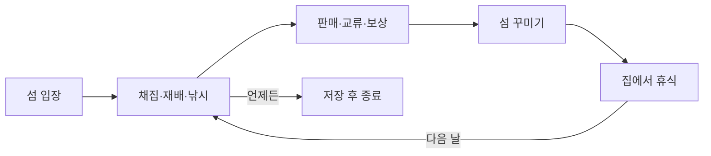

# 소담섬 조작법과 프로젝트 흐름

소담섬은 작은 섬에서 채집·재배·낚시를 즐기고 이웃과 교류하며 생활 공간을 꾸미는 2D 힐링 게임입니다. 시간 제한 없이 원하는 활동을 선택하세요.

## 1 시작과 기본 조작

`Builds/SodamIsland/SodamIsland.exe` 실행 → **첫날 시작하기** 또는 **나의 섬으로 돌아가기**를 누릅니다. 실행 파일은 같은 폴더의 데이터 파일과 함께 사용합니다. Unity에서는 `Assets/Scenes/SodamIsland.unity`를 열고 ▶ Play를 누릅니다.

| 조작 | 기능 |
|---|---|
| WASD / 방향키 | 위·왼쪽·아래·오른쪽 이동 |
| 빈 땅 왼쪽 클릭 | 해당 방향으로 걷기. 장애물은 직접 돌아가기 |
| E / 아래 초록 버튼 | 가까운 나무·텃밭·주민·시설과 상호작용 |
| B → 가구 선택 → 빈 땅 클릭 | 벤치·랜턴·화분 배치 |
| H / 도움말 버튼 | 조작 안내 열기 |
| Esc | 창 닫기·낚시·꾸미기 취소. 창이 없으면 일시 정지 |
| 위쪽 저장 버튼 | 진행 저장 |

**행동이 안 되면:** 열린 창과 꾸미기 모드를 닫고 대상에 가까이 가세요. 아래 초록 버튼의 행동 문구를 확인한 뒤 E를 누릅니다.

## 2 첫날 따라 하기

1. **채집과 인사:** 사과나무에서 E로 사과 3개와 나뭇가지 1개를 얻고, 토리 가까이에서 E로 대화합니다.
2. **낚시와 보상:** 연못 남쪽에서 E → 입질을 기다리기 → 표시가 초록 구간일 때 E. 사과 3개 채집·물고기 1마리·토리 인사를 마치면 오른쪽 일지에서 **선물 받기**를 눌러 80잎과 씨앗 3개를 받습니다.
3. **재배와 거래:** 텃밭에서 E로 심기 → E로 물 주기 → 성장 시간 45초 후 또는 다음 날 E로 수확합니다. 상점에서는 수확물을 한 번에 팔고 씨앗을 삽니다.
4. **꾸미기와 휴식:** 가구 하나에 35잎과 나뭇가지 2개가 필요합니다. 빈 곳에 배치한 뒤 B나 Esc로 끝냅니다. 집 앞에서 E → **푹 자고 다음 날로**를 누르면 열매와 하루 목표가 갱신되고 물을 준 작물이 자랍니다.

오른쪽은 **목표와 가방**, 아래쪽은 **현재 행동과 알림**입니다. 작물은 게임 종료·대화·메뉴·낚시·일시 정지 중에는 성장하지 않습니다. 자유 활동 중 약 20초마다, 주요 행동 후와 정상 종료 시 자동 저장합니다. 종료는 열린 창을 닫고 **Esc → 저장하고 종료하기**를 선택하세요.

## 3 게임 진행 순서도

활동 순서는 자유이며 하루 목표를 모두 달성하지 않아도 다음 날로 쉴 수 있습니다.

## 4 프로젝트 제작과 실행 구조

**제작·검증 순서:** 기획 → Unity 장면·화면 구성 → 이동·상호작용 → 생활 콘텐츠 → 날짜·목표·저장 연결 → 플레이 검증과 수정 → Windows 빌드 → 실행 확인.

**실행 흐름:** 장면 실행 → 저장 기록 불러오기 또는 새 데이터 생성 → 섬 생성 → 입력·상태 갱신과 화면 표시 반복 → 진행 저장 → 종료.

**주요 코드:** `SodamIsland.cs`는 게임 기능과 화면, `Editor/SodamProject.cs`는 장면 준비와 빌드, `Editor/SodamVerification.cs`는 기능 검증을 담당합니다. 모두 `Assets/Sodam` 아래에 있습니다. 수정은 Play를 멈춘 뒤 진행하고, 확인 후 **Sodam → Build Windows game**으로 빌드합니다.
